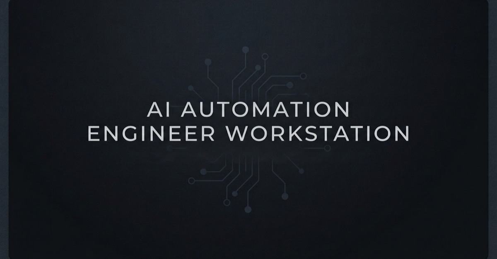

# AI Automation Engineer Workstation: Ubuntu Baseline & Harness

A modular, robust, and security-hardened workstation repository designed for **AI Automation Engineers** and **AI Engineers** (developers running autonomous agents, local test harnesses, and model evals) on Ubuntu and macOS.

Powered by a high-performance, sub-millisecond Rust multi-call engine (`workstation`) with transparent POSIX Bash fallback shims, automated package bootstrapping, supply chain quarantine, credential isolation, git worktree isolation for concurrent agents, task queue supervision, and zero-mock empirical testing suites.

> 📚 **Complete Documentation Suite:**
> - 📖 **[The AI Automation Engineer's Field Manual](docs/MANUAL.md)**: Deep architectural guide explaining agent runtime layers, threat models, supply chain defense, and systems engineering for autonomous agents.
> - 🚀 **[The Quick Start Guide](docs/QUICK-START.md)**: Hands-on 30-minute walkthrough, interactive playground missions, and real-world recipes for controlling agents.
> - 📊 **[Architectural Diagrams & Visual Reference](docs/DIAGRAMS.md)**: Visual architecture, containment layer diagrams, and turn sequence flows.
> - 🧪 **[Empirical Test Receipts](docs/TEST_RECEIPTS.md)**: 17-stage container verification proofs and assertion records.

---

## Key Highlights for AI & Automation Engineers

### 1. Supply Chain Defense (PyPI & npm)
- **7-Day Package Quarantine**: Automatically sets `UV_EXCLUDE_NEWER` to 7 days prior in interactive shells. Zero-day compromised PyPI packages are held back before your local harness or environment downloads them.
- **Malware Checking**: `UV_MALWARE_CHECK=1` queries the OSV vulnerability database on every package addition.
- **Script Execution Guard**: `.npmrc` sets `ignore-scripts=true` to block arbitrary postinstall script execution and token exfiltration.

### 2. Credential Isolation (Zero Ambient API Keys)
- **No Ambient Secrets**: Secrets like `OPENAI_API_KEY`, `ANTHROPIC_API_KEY`, and `HF_TOKEN` are kept **out** of global `~/.bashrc` to prevent accidental exfiltration by untrusted subagents, prompt injections, or testing scripts.
- **`secret-run`**: CLI wrapper that executes a command with secrets loaded into a temporary subshell, keeping the parent shell clean:
  ```bash
  secret-run -- python eval_model.py
  secret-run --env-file ~/.secrets/custom.env -- pytest tests/
  secret-run --strict -- python untrusted_script.py  # Suppresses ambient ./.env in untrusted repos
  ```
- **`direnv` Support**: Includes `.envrc.template` to automatically bind project-specific tokens strictly when `cd`-ing into that project.
- **Machine Overrides**: Use `~/.dotfiles.local` (mode `0600`) for private machine-local configurations.

### 3. Isolated Git Worktrees for Concurrent AI Agents
When running autonomous agents (Antigravity, Claude Code, Codex, Aider), running multiple instances simultaneously in the same working tree causes file and index corruption.
- **`agent-worktree` CLI** (`aw`):
  ```bash
  agent-worktree new auth-refactor       # Creates .worktrees/auth-refactor on branch agent/auth-refactor
  agent-worktree list                   # Lists active worktrees & branch states
  agent-worktree merge auth-refactor    # Merges back to current branch and removes worktree
  agent-worktree remove auth-refactor   # Deletes worktree safely
  agent-worktree clean                  # Prunes stale worktree references
  ```
- Fast aliases: `aw-new`, `aw-ls`, `aw-merge`, `aw-rm`.

### 4. Agent Guardrails, Circuit Breakers & Telemetry
Local agent loops can run amok with recursive subagent spawns or infinite retry loops.
- **Circuit Breaker Commands**:
  ```bash
  agent-status          # View active guardrail limits, rolling hourly usage, and trace counts
  agent-stop            # Emergency stop: touches ~/.agent_stop to halt all local agent loops
  agent-resume          # Clears circuit breaker to resume execution
  agent-traces-compact  # Compact historical trace logs to keep disk footprints bounded
  ```
- **`agent-guard-check`**: Pre-flight verification function for test harnesses. Rejects execution if the circuit breaker is tripped or if hourly limits (`AUTO_AGENT_MAX_PER_HOUR=30`) are exceeded. Features high-performance $O(1)$ tail-bounded rate checking, in-process timestamp resolution, atomic non-blocking file locking (`flock`) for multi-agent concurrency, and periodic auto-compaction.
- **Trace Logs & Maintenance**: Timestamped telemetry stored at `~/.local/state/agent-traces/traces.log` (mode `0600`). Automatically pruned periodically via `AUTO_AGENT_TRACE_MAX_LINES=10000`.

### 5. Local Harness Task Queue (`pueue`)
Run model evals, batch inferences, and agent test suites in the background with concurrency control:
- Pre-configured concurrency groups: `experiments` (max 2 parallel GPU/CPU jobs to prevent OOM) and `agents` (max 4 parallel tasks).
- Commands:
  ```bash
  jexp python eval.py        # Enqueue job to 'experiments' queue
  jagent bash run_harness.sh # Enqueue job to 'agents' queue
  jls                        # Check job queue status
  jfollow <id>               # Stream live output
  jlog <id>                  # View full log
  jkill <id>                 # Cancel job
  ```
- **Dynamic Group Management**: In Pueue v3/v4, group states are stored dynamically in the runtime state database rather than read from `pueue.yml`. The shell baseline automatically handles this on the fly: `.bashrc` and `jrun` auto-initialize the `experiments` (parallel: 2) and `agents` (parallel: 4) queues via `pueue group add` and `pueue parallel` on startup.


### 6. Self-Healing Environment Diagnostic (`doctor`)
Built on "The Spilled Coffee Principle"—if a laptop is destroyed or an environment drifts, you should be back to 100% operational state instantly with zero manual guesswork:
- **`doctor`**: Diagnostic suite verifying 48 system health checks across 31 symlinks, core and AI packages, Docker daemon status, git identity, agent circuit breaker state, MCP boundaries, secret permissions, and binary checksum tooling.
- **`doctor --fix`**: Automatically repairs broken symlinks, launches self-healing sub-routines, and restores configuration integrity.

### 7. Model Context Protocol (MCP) Diagnostics & Configs
Canonical vendor-agnostic MCP configuration for AI harnesses (Antigravity, Claude Code, Cursor, Codex):
- **`config/mcp/mcp.json`**: Standard MCP server configurations (filesystem, git, web fetch).
- **`check-mcp-logs`** (`mcplogs`): Centralized viewer for MCP server logs across harnesses (`check-mcp-logs --tail`, `check-mcp-logs --clear`).

### 8. Developer Automation Workflows
- **`sysinfo`**: Instant hardware, memory, GPU, disk, and networking diagnostic summary in a clean box table.
- **`ensure-docker`** (`edocker`): Ubuntu/Debian native self-healing Docker service validator. Checks socket permissions, group memberships, and initiates systemd/service restart if unresponsive.
- **`pr-checkout`**: Fast PR & branch fetcher with isolated worktree integration (supports GitHub PR numbers and Bitbucket branches):
  ```bash
  pr-checkout 42             # Checkout PR #42 in current working tree
  pr-checkout --worktree 42  # Fetch and isolate PR #42 into .worktrees/pr-42
  pr-checkout feature/auth   # Checkout remote branch directly
  ```
- **`gha-failed-logs`**: Fetches and inspects failed GitHub Actions step logs directly in the terminal without opening a browser.

### 9. Modular Shell Aliases (`~/.bash_aliases.d/`)
Organized by functional domains instead of a monolith:
- `ai.sh`: Agent worktree commands (`aw`, `aw-new`, `aw-merge`), pueue shortcuts (`jrun`, `jexp`, `jagent`, `jls`, `jfollow`), MCP log shortcuts (`mcplogs`).
- `containers.sh`: Docker table view, prune, logs, and self-healing (`dps`, `dstop`, `dprune`, `edocker`).
- `git.sh`: Git status, diff, log graphs, checkout, commit shortcuts (`gs`, `gd`, `gds`, `gl`, `gcm`, `gca`).
- `nav.sh`: Directory navigation (`..`, `...`, `mkcd`, `ll`, `lt`, `lsize`).
- `sys.sh`: System monitoring, safe file operations, archive extraction (`ports`, `path`, `reload`, `extract`, GPU & Slurm).
- Local overrides: Place machine-specific aliases in `~/.bash_aliases.local`.

### 10. Closed-Loop AI Agent Instructions & Boundaries
When you add local CLI tools to your dotfiles, teach your coding agents (Claude Code, OpenCode, Antigravity, Codex) about them in the **same repository**:
- **`config/agents/AGENTS.md`**: Master instructions symlinked to `~/.claude/CLAUDE.md` and referenced by `~/.config/opencode/opencode.json`. Teaches agents about `secret-run`, `agent-worktree`, `pueue`, `doctor`, and the 7-day `uv` quarantine.
- **`config/claude/settings.json`**: Global Claude Code `permissions.deny` rules that block the Read, Grep, and Glob tools from secrets and bulky directories (protecting both credentials and the context window):
  ```json
  "permissions": {
    "deny": [
      "Read(~/.secrets/**)",
      "Read(**/*.env)",
      "Read(**/*.env.*)",
      "Read(./.worktrees/**)",
      "Read(**/.venv/**)",
      "Read(**/node_modules/**)",
      "Read(**/.git/**)"
    ]
  }
  ```
- **`config/opencode/opencode.json`**: Single source of truth referencing the shared `CLAUDE.md` and exclusions.

### 11. Living System Maintenance (`update.sh` / `dotfiles-update`)
Dotfiles drift over time. A single command keeps everything in sync:
```bash
dotfiles-update   # or ./update.sh
```
Executes:
1. `git pull --rebase` to fetch upstream updates.
2. `./scripts/links.sh` to refresh all symlinks.
3. `uv self update` to keep Python tooling current.
4. `doctor --fix` to verify all 48 checks and heal any broken configurations automatically.

### 12. ML, GPU & Python Ergonomics
- **`activate_venv`**: Auto-detects and activates `.venv` in the current working directory or git repo root.
- **Linux RAM `tmpfs`**: Automatically maps `TMPDIR=/run/user/$(id -u)` for RAM-backed scratch disks, speeding up agent disk I/O and reducing SSD wear.
- **GPU & Slurm Monitoring**:
  - `gpu`: Live 1-second watcher for `nvidia-smi`.
  - `gpu-mem`: Formatted table of GPU memory and utilization.
  - Slurm cluster shortcuts: `q`, `qw`, `qq`, `qtest`, `qlogin`, `qdel`.

### 13. Modern CLI Toolchain
- `zoxide` (`z <dir>` smart navigation).
- `bat` / `batcat` (syntax-highlighted file viewing).
- `fd` / `fdfind` (fast directory & file discovery).
- `ripgrep` (`rg`) (blazing-fast regex code search).
- `direnv` (directory-scoped environment management).

---

## Directory Structure

```text
ai-automation-engineer-workstation/
├── .gitignore
├── README.md
├── CONTRIBUTING.md                # Engineering standards & PR contribution guide
├── install.sh                     # Modular installer (profiles: full, cloud, minimal)
├── update.sh                      # Automated updater and self-healing synchronizer
├── docs/
│   ├── MANUAL.md                  # The AI Automation Engineer's Field Manual
│   ├── QUICK-START.md             # Quick Start onboarding guide & walkthrough
│   ├── DIAGRAMS.md                # Architectural diagrams & visual reference
│   └── TEST_RECEIPTS.md           # Empirical container verification receipts
├── bin/
│   ├── agent-worktree             # Isolated git worktrees for concurrent agents
│   ├── check-mcp-logs             # MCP server log viewer and real-time tailer
│   ├── doctor                     # Self-healing environment verification & repair
│   ├── dotfiles-update            # CLI wrapper to update dotfiles and tools
│   ├── ensure-docker              # Linux Docker daemon validator and starter
│   ├── gha-failed-logs            # Terminal GitHub Actions failure log inspector
│   ├── pr-checkout                # Fast PR branch fetcher & worktree reviewer
│   ├── secret-run                 # Scoped credential executor
│   └── sysinfo                    # System overview & hardware diagnostics
├── config/
│   ├── agents/
│   │   └── AGENTS.md              # Master coding agent guidelines & harness tools
│   ├── ai_automation/
│   │   └── ai_automation.sh       # Guardrails, circuit breakers, rate limits & traces
│   ├── bash/
│   │   ├── .bashrc                # Interactive shell with supply chain defense & tools
│   │   ├── .bash_aliases          # Master aliases loader
│   │   ├── aliases.d/             # Modular alias domains
│   │   │   ├── ai.sh              # Worktree, task queue, and MCP aliases
│   │   │   ├── containers.sh      # Docker shortcuts and daemon helpers
│   │   │   ├── git.sh             # Git branch, commit, diff shortcuts
│   │   │   ├── nav.sh             # Directory traversal and listing helpers
│   │   │   └── sys.sh             # System stats, GPU, Slurm, archive extraction
│   │   ├── .bash_profile          # Login profile
│   │   └── .profile               # Fallback profile
│   ├── claude/
│   │   └── settings.json          # Claude Code global settings & permission deny rules
│   ├── git/
│   │   ├── .gitconfig             # Git defaults and aliases
│   │   └── .gitignore_global      # Global ignores (.worktrees, .env, swap, OS files)
│   ├── mcp/
│   │   └── mcp.json               # Canonical Model Context Protocol server configuration
│   ├── npm/
│   │   └── .npmrc                 # ignore-scripts=true supply chain guard
│   ├── opencode/
│   │   └── opencode.json          # OpenCode configuration referencing shared instructions
│   ├── pueue/
│   │   └── pueue.yml              # Task queue config (experiments & agents groups)
│   ├── templates/
│   │   ├── .envrc.template        # Direnv template for per-repo API keys
│   │   └── .dotfiles.local.template # Template for machine-local private settings
│   ├── tmux/
│   │   └── .tmux.conf             # Ergonomic tmux setup with mouse mode & truecolor
│   ├── uv/
│   │   └── uv.toml                # uv package manager config
│   └── vim/
│       └── .vimrc                 # Vim settings with hybrid line numbers
├── scripts/
│   ├── packages.sh                # Automated apt package and pueue binary installer
│   ├── links.sh                   # Symlink manager with automated timestamped backups
│   └── update-checksums.sh        # Pinned binary SHA256 integrity auditor & updater
└── tests/
    ├── Dockerfile                 # Clean Ubuntu test container
    ├── run_tests.sh               # Test runner
    ├── run_security.sh            # Dedicated modular security test runner
    ├── sandbox.sh                 # Interactive zero-risk Docker sandbox test drive
    └── verify_container.sh        # 17-stage automated verification suite
```

---

## Installation

### Quick Decision Matrix

1. **Zero-risk test drive without touching your host machine (macOS / Linux / Windows WSL2)**:
   - **Prerequisites**: `git`, `bash`, `docker`
   - **Command**:
     ```bash
     git clone git@github.com:jacob-adm/ai-automation-engineer-workstation.git
     cd ai-automation-engineer-workstation
     ./tests/sandbox.sh
     ```

2. **Dedicated Ubuntu workstation or VM**:
   - **Prerequisites**: Fresh Ubuntu install (22.04 / 24.04 LTS), regular user with `sudo`, `git`
   - **Command**:
     ```bash
     git clone git@github.com:jacob-adm/ai-automation-engineer-workstation.git
     cd ai-automation-engineer-workstation
     ./install.sh
     ```

3. **Cloud GPU Pod (RunPod, Lambda Labs, Hetzner as `root`)**:
   - **Prerequisites**: Ubuntu pod with network access
   - **Command**:
     ```bash
     ./install.sh --profile cloud
     ```

4. **Minimal dotfile symlinks only (macOS or Linux without root/apt)**:
   - **Prerequisites**: `git`, `bash`
   - **Command**:
     ```bash
     ./install.sh --profile minimal
     ```

### Standard Setup

```bash
# Clone via HTTPS:
git clone https://github.com/jacob-adm/ai-automation-engineer-workstation.git ~/ai-automation-engineer-workstation

# Or clone via SSH:
git clone git@github.com:jacob-adm/ai-automation-engineer-workstation.git ~/ai-automation-engineer-workstation

cd ~/ai-automation-engineer-workstation
./install.sh
```

### Installation Profiles

```bash
# Full installation (Core CLI + AI Dev packages + Pueue + Dotfiles)
./install.sh --profile full

# Headless Cloud GPU Pod (RunPod, Lambda Labs, Hetzner, etc.)
./install.sh --profile cloud

# Minimal (Symlinks dotfiles only without root/apt package installation)
./install.sh --profile minimal

# Non-interactive / Unattended
./install.sh -y --profile full
```

---

## 🌿 Branching Model & Pull Requests

This repository follows a **Trunk-Based Development** model enhanced with **Git Worktrees** for non-blocking agent concurrency:

* **`main`**: Protected, deployable, 100% verified trunk.
* **`feature/<name>`**: Human-engineered features and enhancements.
* **`agent/<task-name>`**: Autonomous agent workflows created via `agent-worktree new <task-name>`.
* **`fix/<name>`**: Bug repairs and security patches.
* **`docs/<name>`**: Documentation, manuals, and test receipts.

### Creating a PR:
1. Create an isolated worktree or branch: `agent-worktree new my-feature` (or `git checkout -b feature/my-feature`).
2. Run the test suite: `./tests/run_tests.sh`.
3. Push to remote: `git push -u origin feature/my-feature`.
4. Open a Pull Request on GitHub targeting `main`.

### Reviewing a PR in an Isolated Worktree:
Reviewers can test any open pull request without interrupting their current working branch:
```bash
pr-checkout --worktree <pr-number>
cd .worktrees/pr-<pr-number> && ./tests/run_tests.sh
```

For the complete guide on PR conventions, commit styles, and standards, see [**CONTRIBUTING.md**](CONTRIBUTING.md).

---

## Docker Test Suite & Interactive Sandbox

### 🧪 Interactive Sandbox Test Drive
Explore the dotfiles and all tools interactively in an isolated Ubuntu container without modifying your host machine:

```bash
./tests/sandbox.sh
```

### 📋 Full Verification Test Suite
Run the full end-to-end 17-stage verification suite in an isolated Ubuntu container:

```bash
./tests/run_tests.sh
```

The automated test verifies:
1. **Installer Execution & Idempotency**: Fresh install, re-run idempotency, backup archiving.
2. **Core & AI Developer Packages**: Package availability (`build-essential`, `python3-pip`, `direnv`, `zoxide`, `batcat`, `fdfind`, `rg`, `fzf`, `uv`, `pueue`).
3. **Symlink Infrastructure**: 31 canonical links across shell, editor, agent configs, and CLI binaries.
4. **Shell Syntax & Startup**: Syntax compilation check and interactive bash startup without errors.
5. **AI Supply Chain Defense & tmpfs**: `UV_EXCLUDE_NEWER`, `UV_MALWARE_CHECK`, npm `ignore-scripts=true`, and RAM-backed `TMPDIR`.
6. **Scoped Secrets Runner**: `secret-run` subshell isolation, mode `0600` fail-closed permission checks, strict AST parsing, and `--strict` untrusted-repo protection.
7. **Isolated Git Worktree Manager**: `agent-worktree` branch creation, concurrent commits, rebase merging, and cleanup.
8. **Circuit Breakers & Telemetry**: `agent-stop`, `agent-resume`, `agent-guard-check`, hourly limits, and mode `0600` log telemetry.
9. **Task Queue Supervision**: `pueue` daemon autostart, runtime state queues (`experiments`, `agents`), and concurrency capping.
10. **Modular Shell Aliases**: `~/.bash_aliases.d/` across ai, containers, git, nav, and sys domains.
11. **Self-Healing Diagnostic Medic**: `doctor` 48-point verification, drift detection, and `doctor --fix` automatic restoration.
12. **Model Context Protocol (MCP)**: `mcp.json` JSON schema compliance, bounded filesystem access, and `check-mcp-logs`.
13. **Developer CLI Utilities**: `sysinfo`, `pr-checkout` with isolated worktree support, `ensure-docker` daemon healing, and `gha-failed-logs`.
14. **AI Coding Agent Configurations**: `CLAUDE.md`, `settings.json`, `opencode.json` schema validation, and sensitive `permissions.deny` boundaries.
15. **Practical Walkthrough Validation**: 60-second web dashboard creation, execution, and local HTTP verification.
16. **Automated Living System Updates**: `dotfiles-update` / `update.sh` rebase, link refresh, `uv self update`, and doctor repair cycle.
17. **Security Invariants & Defenses**: Pinned SHA256 checksums, removal of `curl | sh` pipes, root refusal, and full modular suite via `tests/run_security.sh`.

---

## 🗺️ Architectural Roadmap (v1.0.0 ➔ v2.0.0)

With **`v1.0.0`** established as the hardened, deterministically tested workstation baseline, future milestones target expanding from single-host developer environments into distributed, enterprise-grade agent runtimes:

* **`v1.0.0` — Production Baseline (Current)**:
  - Cryptographic binary pinning (`uv`, `pueue`) & 7-day PyPI supply chain quarantine.
  - Fail-closed secret isolation (`secret-run`) with strict AST parsing and `--strict` ambient `.env` suppression.
  - Local git worktrees (`agent-worktree`) for non-blocking agent concurrency.
  - File-based circuit breakers (`agent-stop`) and 48-check self-healing diagnostic suite (`doctor`).
  - 17-stage containerized test suite with 100% empirical verification receipts.

* **`v1.1.0` — Enterprise Secret Backends**:
  - Native integration of enterprise cloud secret managers (1Password CLI, AWS Secrets Manager, GCP Secret Manager, HashiCorp Vault) directly into `secret-run`.
  - Ephemeral in-memory key injection without writing unencrypted `.env` files to disk.

* **`v1.2.0` — Distributed Agent Queues**:
  - Multi-node `pueue` daemon peering connecting your local workstation to remote Cloud GPU pods (RunPod, Lambda Labs, Hetzner).
  - Unified job submission (`jexp`, `jagent`) with automated workload offloading to remote GPU compute.

* **`v2.0.0` — Kernel-Level Agent Containment**:
  - Evolution from file-based circuit breakers and git worktrees to lightweight **eBPF network filtering** and **cgroup v2 resource limits** per autonomous agent subprocess.
  - Hard OS-enforced egress firewalls preventing credential exfiltration even in the event of complex prompt injection.

---

## Acknowledgements & Credits

This repository draws inspiration from the following open-source dotfiles and AI tooling projects:

- **[yulonglin/dotfiles](https://github.com/yulonglin/dotfiles)** — Autonomous AI agent guardrails, circuit breakers, supply chain quarantine (`UV_EXCLUDE_NEWER`), credential isolation, and `pueue` background task queues.
- **[atxtechbro/dotfiles](https://github.com/atxtechbro/dotfiles)** — Vendor-agnostic Model Context Protocol (`mcp.json`) architecture, MCP log inspection, Docker daemon checking, and PR review workflows.
- **[jplhughes/dotfiles](https://github.com/jplhughes/dotfiles)** & **[drmowinckels/dotfiles](https://github.com/drmowinckels/dotfiles)** — Modular shell configuration structure and terminal ergonomics.

---

## Author & Contact

Jacob Adm is an AI Automation Engineer currently focusing on enterprise autonomous agent orchestration, deterministic runtime architectures, and high-assurance multi-agent systems. Follow for more deep dives on systems engineering with autonomous AI: [linkedin.com/in/jacobadm](http://linkedin.com/in/jacobadm)
