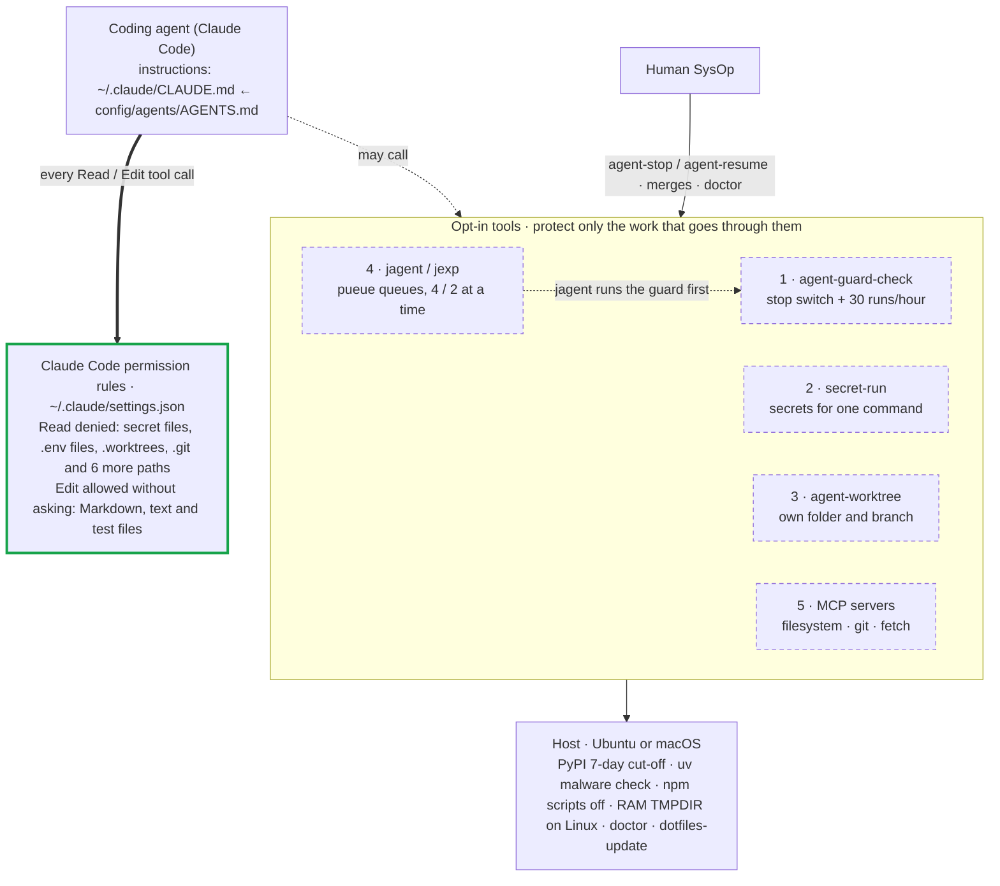
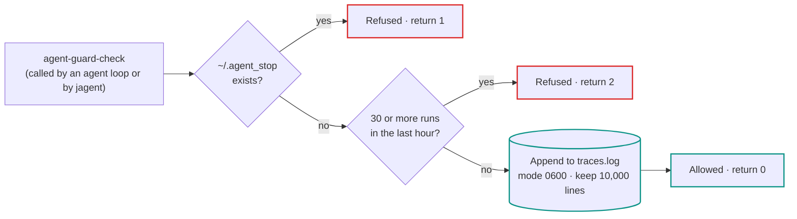
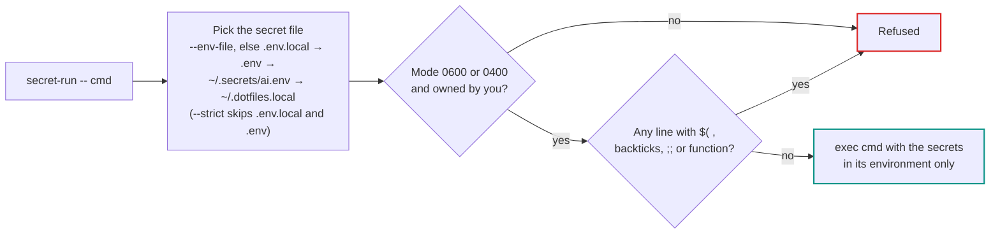
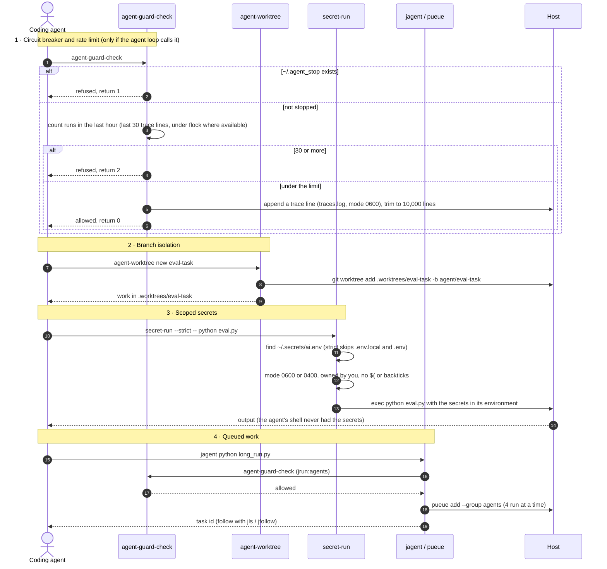

# AI Automation Engineer Workstation — Architecture Diagrams

> 📚 **Navigation:** [README.md](../README.md) | [Field Manual (MANUAL.md)](MANUAL.md) | [Quick Start (QUICK-START.md)](QUICK-START.md) | [Test Receipts (TEST_RECEIPTS.md)](TEST_RECEIPTS.md)

How the workstation keeps a coding agent (for example Claude Code) away from your secrets, your working branch and your machine's capacity. Each diagram is written in Mermaid and rendered by GitHub, so there is one source and it follows your light or dark theme.

---

## Table of Contents
1. [What is enforced and what is opt-in](#what-is-enforced-and-what-is-opt-in)
2. [Diagram 1: Architecture](#diagram-1-architecture)
3. [Diagram 2: One agent task, step by step](#diagram-2-one-agent-task-step-by-step)
4. [Component and file map](#component-and-file-map)

---

## What is enforced and what is opt-in

Read this first. It decides how much each box below protects you.

| Layer | Enforced by | Covers | Does not cover |
| :--- | :--- | :--- | :--- |
| **Claude Code permission rules** (`config/claude/settings.json`, installed to `~/.claude/settings.json`) | Claude Code itself, on every call to its file tools | Reading secret files, `.env` files, `.worktrees/`, `.git/` and other denied paths; editing outside the allowed patterns | Shell commands the agent runs; other agents that don't read this file |
| **Circuit breaker and rate limit** (`agent-guard-check`) | Nothing calls it automatically. `jagent` (`jrun agents`) calls it before queuing; agent loops must call it themselves | Stopping agent loops (`agent-stop`); at most 30 guarded runs per hour | Any command that doesn't go through the guard |
| **`secret-run`, `agent-worktree`, `pueue` queues** | Used when you or the agent run them | Scoped secrets, branch isolation, concurrency limits | Work done without them |
| **Host settings** (`.bashrc`, `.npmrc`) | Your shell and package managers | 7-day PyPI cut-off, uv malware check on syncs, npm install scripts off, RAM scratch on Linux | Packages installed outside `uv` / `npm` |

---

## Diagram 1: Architecture

### 1a · Overview

### 1b · Circuit breaker and rate limit (`config/ai_automation/ai_automation.sh`)

### 1c · Scoped secrets (`secret-run`, Rust)

**How to read it**

- **Thick green border:** enforced by Claude Code, whatever the agent intends. It applies to Claude Code's file tools only. A shell command the agent runs (for example `cat .env`) is not covered by these rules.
- **Dashed boxes and dotted arrows:** tools the agent *may* call. If it doesn't, they do nothing.
- **Red border:** a refusal. **Teal border:** allowed.
- **Circuit breaker:** `agent-stop` creates `~/.agent_stop`, and every later `agent-guard-check` refuses with return code 1. `agent-resume` removes it, and refuses if the stop file belongs to another user. The guard counts the last 30 entries of `traces.log`; it takes a `flock` lock (waiting up to 2 seconds) only where `flock` is installed, which stock macOS doesn't have.
- **`secret-run`:** replaces itself with your command (`exec`), so the secrets exist only in that command's environment and never in your shell. It reads a plaintext secret file; it does not remove the need for one.
- **Worktrees:** isolation comes from the separate branch. Nothing locks `main`; merging is your decision.

---

## Diagram 2: One agent task, step by step

**What each phase guarantees**

1. **Circuit breaker:** a stopped workstation refuses guarded runs, and the hourly limit caps them. Runs that skip the guard aren't counted or stopped.
2. **Branch isolation:** the agent's changes sit on `agent/<task>` in their own folder, so your checkout stays clean until you merge.
3. **Scoped secrets:** the secret file must be private to you, and its lines can't contain command substitution. The secrets reach only the command that `secret-run` starts.
4. **Queued work:** `jagent` checks the guard before queuing, and pueue runs at most 4 agent tasks (and 2 experiments) at a time.

---

## Component and file map

| Subsystem | Files | What the code does | Limits |
| :--- | :--- | :--- | :--- |
| **Permission rules** | `config/claude/settings.json` → `~/.claude/settings.json` | Denies reading `~/.secrets/**`, `**/*.env`, `**/*.env.*`, `**/.dotfiles.local`, `./.worktrees/**`, `**/.venv/**`, `**/__pycache__/**`, `**/.git/**`, `**/node_modules/**`, `**/.pueue/**`; allows editing `**/*.md`, `**/*.txt`, `**/tests/**`, `**/test_*.py` without asking | Claude Code file tools only, not shell commands |
| **Agent instructions** | `config/agents/AGENTS.md` → `~/.claude/CLAUDE.md`, `~/.config/agents/AGENTS.md` | Shared instructions for agents | Instructions, not enforcement |
| **Circuit breaker** | `config/ai_automation/ai_automation.sh` | `agent-stop` / `agent-resume` / `agent-guard-check`; refuses when `~/.agent_stop` exists | Applies only to callers of `agent-guard-check` |
| **Rate limit and traces** | `~/.local/state/agent-traces/traces.log` | 30 guarded runs per hour (`AUTO_AGENT_MAX_PER_HOUR`); log mode 0600, trimmed to 10,000 lines (`AUTO_AGENT_TRACE_MAX_LINES`) | The log is user-writable and trimmed, so it is a record, not tamper-proof |
| **Secrets** | `bin/secret-run` → `workstation secret-run` (Rust) | Finds the secret file, checks mode 0600/0400 and ownership, rejects `$(`, backticks, `;;`, `function`, then `exec`s the command | Secrets still live in a plaintext file on disk |
| **Worktrees** | `bin/agent-worktree` → `workstation worktree`, `config/bash/aliases.d/ai.sh` (`aw`) | `.worktrees/<task>` on `agent/<task>`; merge removes the worktree and branch | Nothing prevents direct commits to `main` |
| **Queues** | `config/pueue/pueue.yml`, `config/bash/aliases.d/ai.sh` | `agents` group 4 parallel (guarded); `experiments` 2 parallel (not guarded) | Only work submitted through `jrun` |
| **MCP servers** | `config/mcp/mcp.json`, `bin/check-mcp-logs` | filesystem server on `~/Development`, plus git and fetch; log viewer | Server packages are fetched unpinned (`npx -y`, `uvx`) |
| **Supply chain** | `config/bash/.bashrc`, `config/npm/.npmrc` | PyPI releases newer than 7 days are ignored (`UV_EXCLUDE_NEWER`); OSV malware check on uv syncs; npm install scripts off, `audit` on, exact versions saved | `UV_MALWARE_CHECK=1` makes uv (0.11.16+, pinned 0.13.7) check locked packages against OSV known-malware advisories on each sync; a uv preview feature, malware only, not CVEs. npm has no age cut-off |
| **RAM scratch** | `config/bash/.bashrc` | `TMPDIR=/run/user/$UID` when that folder exists | Linux only |
| **Health and updates** | `bin/doctor` (`doctor --fix`), `bin/dotfiles-update`, `update.sh` | Checks links, packages, Docker, git, guardrails and secrets; repairs links; pulls updates | — |
