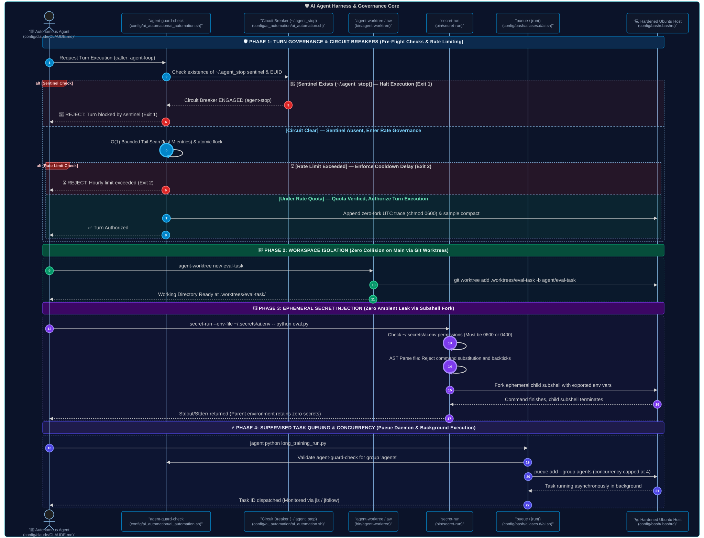

```mermaid
flowchart TB
    %% -------------------------------------------------------------------------
    %% Operators & Autonomous Agents
    %% -------------------------------------------------------------------------
    subgraph ACTORS ["👤 OPERATORS & AUTONOMOUS AGENTS"]
        direction LR
        HUMAN["👨‍💻 Human Engineer<br/>config/bash/.bashrc<br/>config/tmux/.tmux.conf"]
        AGENT["🤖 Autonomous Coding Agent<br/>config/claude/CLAUDE.md<br/>config/claude/settings.json"]
    end

    %% -------------------------------------------------------------------------
    %% THE HARNESS (PRIMARY STANDOUT CONTAINER)
    %% -------------------------------------------------------------------------
    subgraph HARNESS ["🛡️  AI AGENT HARNESS & GOVERNANCE SUBSTRATE (CONTAINMENT LAYER)  "]
        direction TB

        subgraph GOVERNANCE ["Pillar 1: Turn Governance & Circuit Breakers (config/ai_automation/ai_automation.sh)"]
            direction TB
            GUARD{"agent-guard-check<br/>config/ai_automation/ai_automation.sh"}
            SENTINEL{"~/.agent_stop<br/>Sentinel Exists?"}
            HALT["🚨 EMERGENCY HALT<br/>agent-stop engaged<br/>Blocks all harness turns"]
            RATE{"Sliding Rate Limiter<br/>AUTO_AGENT_MAX_PER_HOUR (30)"}
            RATE_REJECT["⏳ RATE LIMITED<br/>Enforces cooldown delay"]
            TRACE[("📝 Audit Telemetry<br/>~/.local/state/agent-traces/traces.log<br/>(Enforced 0600 Permissions)")]
        end

        subgraph SECRETS ["Pillar 2: Zero-Ambient Secret Isolation (bin/secret-run)"]
            direction TB
            SECRUN["🔐 CLI: bin/secret-run"]
            CHMOD{"Verify Permissions<br/>Mode 0600 or 0400?"}
            SEC_REJECT["🛑 REJECT INJECTION<br/>Fail-Closed Exit (Code 1)"]
            AST["Safe Subshell AST Parser<br/>bin/secret-run<br/>(Blocks Command Substitution)"]
            CHILD["Ephemeral Subshell<br/>Injects secrets into child process only<br/>Zero ambient leak in parent env"]
        end

        subgraph WORKTREE ["Pillar 3: Git Worktree Sandboxing (bin/agent-worktree)"]
            direction TB
            AW["🌿 CLI: bin/agent-worktree<br/>Alias: config/bash/aliases.d/ai.sh (aw)"]
            SANDBOX["Sandboxed Git Worktree<br/>.worktrees/task-name/<br/>(Protected main branch)"]
            MERGE["Atomic Merge & Cleanup<br/>agent-worktree merge<br/>Deletes worktree upon success"]
        end

        subgraph QUEUE ["Pillar 4: Task Queue Supervision (config/pueue/pueue.yml)"]
            direction TB
            JRUN["⚡ Wrapper: jrun / jagent / jexp<br/>config/bash/aliases.d/ai.sh"]
            DAEMON["pueue Daemon<br/>config/pueue/pueue.yml"]
            Q_AGENTS["Agents Pool<br/>Parallel Limit: 4"]
            Q_EXP["Experiments Pool<br/>Parallel Limit: 2"]
        end

        subgraph MCP ["Pillar 5: Model Context Protocol Governance (config/mcp/mcp.json)"]
            direction TB
            MCP_CONF["Bounded Server Registry<br/>config/mcp/mcp.json"]
            MCP_LOGS["Log Inspector & Truncator<br/>bin/check-mcp-logs<br/>~/.local/state/mcp/*.log"]
        end
    end

    %% -------------------------------------------------------------------------
    %% Host Substrate & Execution Targets
    %% -------------------------------------------------------------------------
    subgraph HOST ["💻 HARDENED UBUNTU HOST SUBSTRATE"]
        direction LR
        RAM["⚡ RAM tmpfs Scratch<br/>/run/user/$UID<br/>(Set in config/bash/.bashrc)"]
        PYPI["📦 Supply Chain Shield<br/>config/uv/uv.toml<br/>config/npm/.npmrc<br/>(7-day quarantine & OSV checks)"]
        REPO[("📁 Git Repository Root<br/>config/git/.gitconfig")]
        DOCTOR["🩺 Self-Healing Medic<br/>bin/doctor (48 checks)<br/>Auto-Repair: doctor --fix"]
        UPDATE["🔄 Living System Updater<br/>bin/dotfiles-update<br/>update.sh & scripts/links.sh"]
    end

    %% -------------------------------------------------------------------------
    %% Interconnection Flows
    %% -------------------------------------------------------------------------
    HUMAN --> JRUN
    HUMAN --> AW
    HUMAN --> DOCTOR
    HUMAN --> UPDATE

    AGENT ==> GUARD
    AGENT ==> SECRUN
    AGENT ==> AW
    AGENT ==> MCP_CONF

    %% Governance Interception Flow
    GUARD --> SENTINEL
    SENTINEL -- "Yes (Stopped)" --> HALT
    SENTINEL -- "No (Active)" --> RATE
    RATE -- "Quota Exceeded" --> RATE_REJECT
    RATE -- "Turn Allowed" --> TRACE

    %% Secret Isolation Interception Flow
    SECRUN --> CHMOD
    CHMOD -- "Insecure (over 0600)" --> SEC_REJECT
    CHMOD -- "Valid (0600/0400)" --> AST
    AST --> CHILD

    %% Worktree Interception Flow
    AW --> SANDBOX
    SANDBOX -.->|"Completed Work"| MERGE
    MERGE --> REPO

    %% Task Queue Interception Flow
    JRUN --> DAEMON
    DAEMON -.->|"Guard Verified"| Q_AGENTS
    DAEMON --> Q_EXP

    %% MCP Flow
    MCP_CONF --> MCP_LOGS

    %% Substrate Outputs
    TRACE -.-> RAM
    CHILD -.-> PYPI
    Q_AGENTS -.-> RAM

    %% -------------------------------------------------------------------------
    %% Styling Directives
    %% -------------------------------------------------------------------------
    style HARNESS fill:#0b1329,stroke:#00f0ff,stroke-width:3px,color:#ffffff
    style GOVERNANCE fill:#1e293b,stroke:#38bdf8,stroke-width:1.5px,color:#e2e8f0
    style SECRETS fill:#1e293b,stroke:#38bdf8,stroke-width:1.5px,color:#e2e8f0
    style WORKTREE fill:#1e293b,stroke:#38bdf8,stroke-width:1.5px,color:#e2e8f0
    style QUEUE fill:#1e293b,stroke:#38bdf8,stroke-width:1.5px,color:#e2e8f0
    style MCP fill:#1e293b,stroke:#38bdf8,stroke-width:1.5px,color:#e2e8f0
    style ACTORS fill:#2e1065,stroke:#a855f7,stroke-width:2px,color:#f3e8ff
    style HOST fill:#18181b,stroke:#71717a,stroke-width:1.5px,color:#e4e4e7

    style HALT fill:#450a0a,stroke:#ef4444,stroke-width:2px,color:#fecaca
    style SEC_REJECT fill:#450a0a,stroke:#ef4444,stroke-width:2px,color:#fecaca
    style RATE_REJECT fill:#450a0a,stroke:#ef4444,stroke-width:2px,color:#fecaca

    style CHILD fill:#064e3b,stroke:#10b981,stroke-width:2px,color:#d1fae5
    style SANDBOX fill:#064e3b,stroke:#10b981,stroke-width:2px,color:#d1fae5
    style MERGE fill:#064e3b,stroke:#10b981,stroke-width:2px,color:#d1fae5
```

# AI Automation Engineer Workstation — Architectural Diagrams & Visual Reference

> 📚 **Navigation:** [README.md](../README.md) | [Field Manual (MANUAL.md)](MANUAL.md) | [Quick Start (QUICK-START.md)](QUICK-START.md) | [Test Receipts (TEST_RECEIPTS.md)](TEST_RECEIPTS.md)

This document provides a visual and operational breakdown of the **AI Automation Engineer Workstation** architecture, illustrating how autonomous coding agents (e.g., Claude Code, OpenCode) are safely contained, governed, and observed while executing on an Ubuntu host.

---

## Table of Contents
1. [Architecture Overview & Containment Strategy](#architecture-overview--containment-strategy)
2. [Diagram 1: System Containment Architecture (Macro View)](#diagram-1-system-containment-architecture-macro-view)
   - [Rendered Macro Diagram](#rendered-macro-diagram)
   - [Live Mermaid Diagram](#live-mermaid-diagram-macro)
   - [Raw Mermaid Source](#raw-mermaid-source-macro)
   - [Architectural Narrative](#architectural-narrative)
3. [Diagram 2: Runtime Turn Interception & Execution Sequence (Micro View)](#diagram-2-runtime-turn-interception--execution-sequence-micro-view)
   - [Rendered Micro Diagram](#rendered-micro-diagram)
   - [Live Mermaid Sequence](#live-mermaid-sequence-micro)
   - [Raw Mermaid Source](#raw-mermaid-source-micro)
   - [Execution Lifecycle Walkthrough](#execution-lifecycle-walkthrough)
4. [Component & File Mapping Matrix](#component--file-mapping-matrix)

---

## Architecture Overview & Containment Strategy

Autonomous AI coding agents operating directly on a developer workstation pose distinct systems challenges:
- **Ambient Credential Exfiltration**: Agents reading `.env` files in parent environments or command histories.
- **Runaway Autonomous Loops**: Agents consuming excessive API tokens or thrashing compute in unmonitored cycles.
- **Working Tree Collision**: Agents mutating the primary checkout, breaking developer flow, or making destructive git commits.
- **Supply Chain Poisoning**: Agents installing unpinned, zero-day compromised PyPI or npm packages.

To solve this, the workstation places a dedicated **Harness & Governance Substrate** between the agent and the host operating system. The harness acts as a strict interception gateway:

```
[ Operators / Autonomous Agents ]
               │
               ▼
 ╔═══════════════════════════════════════════════════════════════════════╗
 ║        🛡️ AI AGENT HARNESS & GOVERNANCE SUBSTRATE (CONTAINMENT)       ║
 ║                                                                       ║
 ║  • Pillar 1: Turn Governance & Circuit Breakers (ai_automation.sh)    ║
 ║  • Pillar 2: Zero-Ambient Secret Isolation (secret-run)               ║
 ║  • Pillar 3: Git Worktree Sandboxing (agent-worktree / aw)            ║
 ║  • Pillar 4: Supervised Task Queuing (pueue / jrun)                   ║
 ║  • Pillar 5: Model Context Protocol Governance (mcp.json)             ║
 ╚═══════════════════════════════════════════════════════════════════════╝
               │
               ▼
[ Hardened Host Substrate: RAM tmpfs, 7-Day PyPI Quarantine, doctor Medic ]
```

---

## Diagram 1: System Containment Architecture (Macro View)

### Rendered Macro Diagram



### Live Mermaid Diagram (Macro)



### Raw Mermaid Source (Macro)

````markdown

````

### Architectural Narrative

1. **The Containment Layer (`HARNESS`)**:
   Enclosed in a prominent dark navy container with an electric cyan border (`#00f0ff`), the Harness intercepts every agent command. Agents cannot execute arbitrary bash commands against production state; they must operate through the sandboxes provided by the five pillars.
2. **Pillar 1: Turn Governance (`config/ai_automation/ai_automation.sh`)**:
   Enforces pre-flight checks before each turn. If a human engineer runs `agent-stop`, the `~/.agent_stop` sentinel file is created, causing all agent loops to instantly abort. If allowed, invocations are audited to `~/.local/state/agent-traces/traces.log` (mode `0600`).
3. **Pillar 2: Zero-Ambient Secrets (`bin/secret-run`)**:
   Replaces persistent `.env` files in parent shells with ephemeral child process injection. It validates file permissions (`0600`/`0400`), sanitizes values via AST parsing to prevent command execution, and discards secrets upon process exit.
4. **Pillar 3: Worktree Sandboxing (`bin/agent-worktree`)**:
   Isolates agent code generations in separate git worktrees located at `.worktrees/<task>`. The main branch remains pristine until an explicit merge is approved.
5. **Pillar 4: Task Queue Supervision (`config/pueue/pueue.yml`)**:
   Pueue manages background compute pools (`agents` capped at concurrency 4, `experiments` capped at 2), preventing autonomous agents from exhausting host CPU/RAM resources.
6. **Pillar 5: Model Context Protocol Governance (`config/mcp/mcp.json`)**:
   Constrains MCP tool integrations to explicit paths and auditable command wrappers with automated log inspection (`bin/check-mcp-logs`).

---

## Diagram 2: Runtime Turn Interception & Execution Sequence (Micro View)

### Rendered Micro Diagram



### Live Mermaid Sequence (Micro)


### Raw Mermaid Source (Micro)

````markdown

````

### Execution Lifecycle Walkthrough

1. **Pre-flight Interception**: Before generating code or calling tools, the agent triggers `agent-guard-check`. The guard checks for the presence of the `~/.agent_stop` sentinel file. If present, execution terminates immediately.
2. **Rate Quota Enforcement**: If the circuit breaker is clear, the guard scans `~/.local/state/agent-traces/traces.log` to calculate runs within the last 3600 seconds. If `AUTO_AGENT_MAX_PER_HOUR` is reached, it exits with return code `2`.
3. **Workspace Isolation**: Instead of making edits in the active working tree, the agent invokes `agent-worktree new <task>`. This provisions a dedicated branch under `.worktrees/<task>/` where files can be tested, staged, and benchmarked without dirtying the root directory.
4. **Secret Injection**: Whenever database keys or model API tokens are required, `secret-run` evaluates the file permissions (`0600`/`0400`) and safely parses key-value pairs into a short-lived child subshell. The host parent shell never retains ambient secret tokens in environment memory.
5. **Supervised Queue Hand-off**: Heavy tasks (e.g. model training, evaluation suites) are submitted via `jagent` into the pueue daemon, which schedules execution within strict pool concurrency boundaries.

---

## Component & File Mapping Matrix

| Subsystem | Key Files | Invariants Enforced | Operational Role |
| :--- | :--- | :--- | :--- |
| **Circuit Breaker** | `config/ai_automation/ai_automation.sh` | Sentinel file presence immediately aborts all harnesses. Resumption requires matching EUID. | Emergency stop & hourly execution limits |
| **Telemetry** | `~/.local/state/agent-traces/traces.log` | File permissions strictly constrained to `0600`. | Immutable invocation logs & rate metrics |
| **Secret Runner** | `bin/secret-run` | Zero ambient secrets in parent shell. Insecure permissions (`>0600`) rejected. | Ephemeral child subshell injection |
| **Worktree Manager** | `bin/agent-worktree`, `config/bash/aliases.d/ai.sh` | Main branch protected; all agent branches isolated to `.worktrees/`. | Non-destructive filesystem sandboxing |
| **Task Queue** | `config/pueue/pueue.yml`, `config/bash/aliases.d/ai.sh` | Concurrency capped at 4 for agents, 2 for experiments. | Background execution & resource budgeting |
| **MCP Boundaries** | `config/mcp/mcp.json`, `bin/check-mcp-logs` | Filesystem server prevents bare `.` mounts; logs audited in `~/.local/state/mcp/`. | Model Context Protocol scoping |
| **Medic Diagnostics** | `bin/doctor`, `update.sh` | 48 automated checks across symlinks, packages, Docker, Git, guardrails, and secrets. | Configuration drift detection & self-healing |
| **Supply Chain** | `config/bash/.bashrc`, `config/uv/uv.toml`, `config/npm/.npmrc` | 7-day PyPI quarantine (`UV_EXCLUDE_NEWER`), OSV malware scanning, npm scripts disabled. | Supply chain attack immunity |
| **Memory Filesystem** | `config/bash/.bashrc` | `TMPDIR` redirected to `/run/user/$UID` (RAM tmpfs). | High-speed scratch I/O & SSD endurance |
| **Living Updater** | `bin/dotfiles-update`, `update.sh`, `scripts/links.sh` | Rebase sync, symlink refresh, and `doctor --fix` self-healing pipeline. | Automated workstation maintenance |
